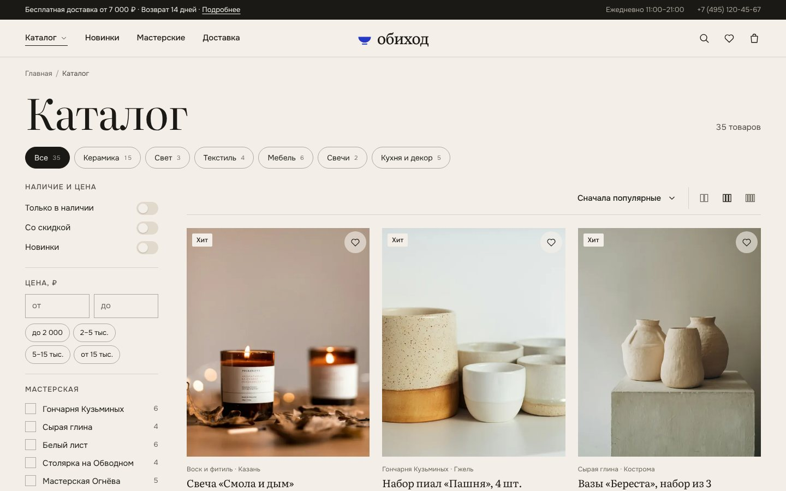
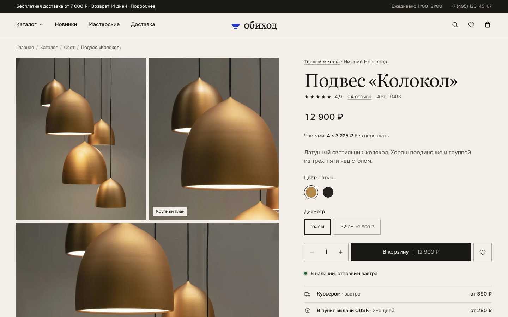
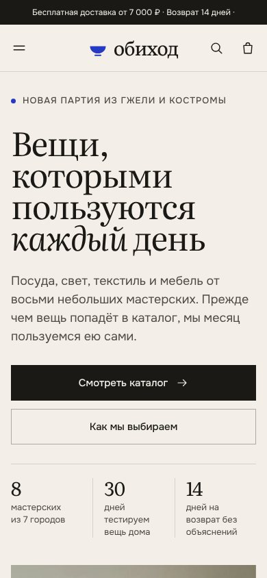

# Обиход — шаблон интернет-магазина

Готовый интернет-магазин вещей для дома: главная, каталог с фильтрами, карточка товара, корзина, оформление заказа, «О магазине», «Доставка и оплата», 404. Работает без сборки и без сервера: обычные HTML, CSS и JavaScript. Открыть `index.html` в браузере — и всё работает, включая корзину.

Сделан так, чтобы его можно было за вечер перекрасить под другого клиента: цвета и шрифты — в одном файле, название и контакты — в другом, товары — в третьем.


| Каталог | Товар | Телефон |
|---|---|---|
|  |  |  |

---

## Что внутри

| Страница | Что умеет |
|---|---|
| `index.html` — главная | Первый экран с фото и точкой-ссылкой на товар, категории, лента новинок, блок про мастерские, бегущая строка с условиями, **«Собрать стол»** — фото с точками, каждая ведёт на товар, и кнопка «добавить всё в корзину», популярное, отзывы, преимущества |
| `catalog.html` — каталог | Категории, фильтры (наличие, скидка, новинки, цена, мастерская) с подсчётом товаров, сортировка, поиск, избранное, вид сетки 2/3/4 колонки, «Показать ещё», плитка-врезка в сетке, панель фильтров на телефоне. Все фильтры пишутся в адрес — ссылкой можно поделиться |
| `product.html?id=p01` — товар | Галерея (на телефоне — карусель), просмотр фото на весь экран, выбор цвета и варианта с доплатой, количество, «оплата частями», наличие, способы доставки, характеристики, уход, мастерская, отзывы с графиком оценок, «С этим покупают», «Вы смотрели», липкая кнопка покупки на телефоне, «Сообщить о поступлении», если товара нет |
| Корзина (выезжает справа) | Количество, удаление, полоска «до бесплатной доставки осталось …», «добавить к заказу» |
| `checkout.html` — оформление | Контакты, маска телефона, способы доставки и оплаты, промокод, проверка полей с подсказками, экран «Заказ оформлен» с номером и сроками |
| `about.html`, `delivery.html`, `404.html` | Контентные страницы: цифры, шаги, цитата, мастерские, таблица доставки, FAQ |

Ещё: поиск по всему каталогу с подсветкой, мега-меню каталога, избранное, синхронизация корзины между вкладками, мобильное меню, доступность с клавиатуры (Tab, Esc, стрелки), уважение к настройке «уменьшить движение».

---

## Как посмотреть

**Просто:** двойной клик по `index.html`.

**Как на настоящем хостинге** (рекомендую, так точнее):

```bash
cd путь/к/папке
python3 -m http.server 8000
# открыть http://localhost:8000
```

---

## Структура

```
index.html, catalog.html, product.html, checkout.html, about.html, delivery.html, 404.html
assets/
  css/
    tokens.css      ← ЦВЕТА, ШРИФТЫ, СКРУГЛЕНИЯ, ОТСТУПЫ — перекрашивать здесь
    fonts.css       ← подключение шрифтов (лежат локально в assets/fonts)
    styles.css      ← все компоненты; трогать не обязательно
  js/
    config.js       ← НАЗВАНИЕ, КОНТАКТЫ, МЕНЮ, ДОСТАВКА, ОПЛАТА, ПРОМОКОДЫ
    data.js         ← ТОВАРЫ, КАТЕГОРИИ, МАСТЕРСКИЕ (ПРОИЗВОДИТЕЛИ), ОТЗЫВЫ
    app.js          ← ядро: корзина, шапка, подвал, поиск
    home.js, catalog.js, product.js, checkout.js, info.js — логика страниц
  img/
    products/       ← фото товаров: p01.webp, p01-sm.webp, p01-detail.webp, p01-full.webp
    editorial/      ← большие фото для главной и страниц
    favicon.svg
tools/
  prepare_images.py ← нарезает фото клиента в нужные размеры
```

---

## Как переделать под клиента — по шагам

### 1. Название, контакты, условия — `assets/js/config.js`

- `brand.name` — слово в логотипе и огромная надпись в подвале (подгоняется по ширине сама).
- `brand.showMark: false` — убрать значок-пиалу слева от названия.
- `contacts` — телефон, почта, адрес, часы, соцсети.
- `promo` — текст в чёрной плашке над шапкой.
- `nav`, `footer` — пункты меню и колонки ссылок в подвале.
- `freeShippingFrom` — с какой суммы доставка бесплатная.
- `shipping`, `payment` — способы доставки и оплаты. Они сами попадут в карточку товара, оформление заказа и страницу «Доставка».
- `promoCodes` — промокоды и скидки (`0.10` = 10%).

### 2. Цвета и шрифты — `assets/css/tokens.css`

Главное:

```css
--c-paper:  #F3EFE8;   /* фон */
--c-ink:    #1A1915;   /* текст и основные кнопки */
--c-accent: #2639C4;   /* фирменный цвет: значки, бегущая строка, «Новинка», кнопка оплаты */
--font-display: 'Literata', …;  /* заголовки */
--font-body:    'Onest', …;     /* текст */
```

Готовые сочетания, чтобы не придумывать:

| Ниша | Фон | Текст | Акцент | Заголовки |
|---|---|---|---|---|
| Сейчас (дом, керамика) | `#F3EFE8` | `#1A1915` | `#2639C4` кобальт | Literata |
| Цветы, свечи, косметика | `#F6F1EE` | `#2B2024` | `#B4485B` пион | Literata или Cormorant |
| Кофе, чай, еда | `#F1EBE1` | `#1F1A14` | `#B5552B` терракота | Brygada 1918 |
| Одежда, обувь | `#F4F4F2` | `#111111` | `#111111` (без акцента) | Onest 600 вместо засечек |
| Детские товары | `#FBF7EF` | `#24323F` | `#2F8F6B` | Geologica |
| Техника, гаджеты | `#F2F3F5` | `#0E1116` | `#3A5BFF` | Inter Tight |

Проверяйте контраст текста к фону (не ниже 4.5:1) — например, на webaim.org/resources/contrastchecker.

**Сменить шрифт.** Возьмите шрифт с кириллицей на fonts.google.com. Самый простой путь — заменить содержимое `assets/css/fonts.css` одной строкой:

```css
@import url('https://fonts.googleapis.com/css2?family=Brygada+1918:ital,wght@0,400..700;1,400..700&family=Onest:wght@300..700&display=swap');
```

и поменять имена в `--font-display` / `--font-body`. Локальные файлы в `assets/fonts` после этого можно удалить.

### 3. Товары — `assets/js/data.js`

Каждый товар — объект с понятными полями (описание полей — в начале файла). Главное:

- `id` — по нему ищутся фото: `assets/img/products/<id>.webp` и т. д.
- `cat` — id категории из `categories`, `maker` — id производителя из `makers`.
- `price`, `old` — цена и старая цена (для скидки), `stock: 0` — «нет в наличии».
- `badges: ['new', 'hit', 'sale']` — метки на карточке.
- `colors` — кружки цветов, `option` — варианты с доплатой (размер, объём, комплект).

«Мастерские» можно переименовать в «бренды», «фермы», «дизайнеров» — это просто текст на страницах. Для одежды `option` превращается в размеры: `{ label: 'Размер', values: [{ n: 'S', d: 0 }, { n: 'M', d: 0 }, { n: 'L', d: 0 }] }`.

Блок «Собрать стол» на главной — `look` в конце `data.js`: фото и точки на нём (`x`, `y` — проценты от ширины и высоты).

### 4. Фото — `tools/prepare_images.py`

Назовите фото клиента по id товаров (`p01.jpg`, `p02.jpg` …), сложите в одну папку и запустите:

```bash
pip install pillow
python3 tools/prepare_images.py фото_клиента assets/img/products
```

Скрипт сделает по четыре файла на товар: основное фото 4:5, уменьшенное, крупный план для наведения и полный кадр для галереи. Если товар не по центру — `--focus 0.4,0.55` (доли ширины и высоты).

Большие фото для главной и страниц — в `assets/img/editorial`, ссылки на них прямо в HTML (`index.html`, `about.html`, `delivery.html`).

### 5. Тексты на страницах

Тексты первого экрана, «О магазине», FAQ и т. п. написаны прямо в HTML-файлах — откройте и замените. В `index.html` у первого экрана `data-hero-product="p07"` — какой товар подписан под фото и куда ведёт точка; `data-hotspot-x/y` — где стоит точка.

Не забудьте `<title>` и `<meta name="description">` в каждом HTML-файле и `favicon.svg`.

---

## Как получать заказы

Сейчас магазин в демо-режиме: заказ «оформляется», но никуда не уходит. Чтобы заказы приходили, укажите адрес в `config.js`:

```js
orderEndpoint: 'https://formspree.io/f/ваш_id',
```

Сайт отправит POST-запрос с JSON: номер заказа, контакты, адрес, способ доставки и оплаты, промокод, список товаров с ценами и итоги. Варианты:

- **Formspree / Getform** — проще всего: регистрируетесь, получаете адрес, заказы приходят на почту. Бесплатного тарифа хватит на старте.
- **Google Apps Script** — заказы пишутся в Google-таблицу, оттуда можно отправлять в Telegram.
- **Свой сервер или CMS** — принимаете JSON и делаете что угодно.

⚠️ Не вставляйте токен Telegram-бота прямо в код сайта — его увидит любой посетитель. Отправка в Telegram — только через свой сервер или Apps Script.

Настоящая онлайн-оплата (ЮKassa, CloudPayments, Робокасса, Т-Банк) подключается на стороне сервера: он создаёт платёж и возвращает ссылку, на которую сайт переводит покупателя. Это отдельная работа — закладывайте её в смету.

То же для подписки в подвале: `subscribeEndpoint`.

---

## Как опубликовать

Подойдёт любой хостинг статических сайтов — нужно просто загрузить все файлы:

- **GitHub Pages:** Settings → Pages → Branch: `main`, папка `/` → через минуту сайт будет на `имя.github.io/репозиторий`.
- **Netlify / Vercel:** перетащить папку в окно браузера (Netlify Drop).
- **Beget, Timeweb, REG.RU:** залить файлы в `public_html` через файловый менеджер или FTP.

---

## Перед сдачей клиенту — чек-лист

- [ ] Название, контакты, юрлицо и ИНН в `config.js`
- [ ] Цвета и шрифты в `tokens.css`, свой `favicon.svg`
- [ ] Товары и фото клиента, проверены цены и наличие
- [ ] Тексты: первый экран, «О магазине», «Доставка», FAQ
- [ ] `<title>` и `description` во всех HTML
- [ ] Приём заказов (`orderEndpoint`) — проверить тестовым заказом
- [ ] Ссылки на оферту и политику конфиденциальности (сейчас стоят `#`)
- [ ] Согласие на обработку персональных данных (152-ФЗ) — текст от юриста клиента
- [ ] Яндекс Метрика: вставить счётчик перед `</head>` во все HTML
- [ ] Открыть на телефоне и пройти покупку от начала до конца

---

## Права на материалы

- **Фотографии** — с Unsplash (unsplash.com), по лицензии Unsplash: можно бесплатно использовать в коммерческих проектах, указывать автора не обязательно. Нельзя продавать сами фото как есть. Для сайта клиента лучше заменить их на его собственные снимки товаров.
- **Шрифты** Literata и Onest — Google Fonts, лицензия SIL Open Font License: свободно для любых проектов.
- **Иконки** нарисованы для этого шаблона, свободны.
- **Код** — ваш, используйте и переделывайте как угодно.
